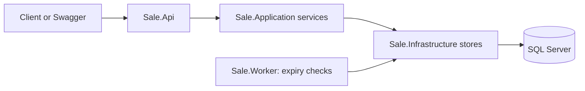

# 1. Architecture

The solution uses .NET 8, Minimal APIs, Entity Framework Core, and SQL Server. It has separate layers, but does not implement every pattern often used in Clean Architecture. Minimal APIs describe how HTTP routes are written; they do not prevent us from using layers.

## Running parts

The API and worker are separate processes. Both connect to the same database. Running the API does not start the worker.

A reservation request goes directly through the API to a SQL transaction. It does not wait in a worker queue. The API returns success only after the hold is saved.

The current worker only finds expired holds and returns their quantity to the sale. It does not approve purchases, call a payment service, or consume `ProcessingJobs`.

## Layers and dependencies

| Project | Responsibility | Project references |
| --- | --- | --- |
| `Sale.Domain` | Entities and reservation states | None |
| `Sale.Application` | Input validation, service methods, and storage contracts | Domain |
| `Sale.Infrastructure` | SQL access, transactions, migrations, seed data, and expiry worker implementation | Application, Domain |
| `Sale.Api` | HTTP endpoints, Swagger, request logging, and service setup | Application, Infrastructure |
| `Sale.Worker` | Start and stop the background service | Infrastructure |

The worker implementation lives in Infrastructure because it uses database services. The small Worker project provides its own process and configuration. This lets us run or restart it separately from the API.

## Database model

| Table | Meaning |
| --- | --- |
| `Tenants` | Stores using the service |
| `Products` | Each store's product catalog |
| `SaleEvents` | A sale with a start and end time |
| `SaleEventItems` | Product price and quantity allocated to one sale |
| `Reservations` | Temporary holds and their final state |
| `ProcessingJobs` | Pending work saved when a hold is confirmed |

Products belong to tenants. A sale belongs to a tenant and has sale items. A reservation points to one sale item. A confirmed reservation has one processing job.

Keys and foreign keys include the tenant where needed. They prevent a reservation from pointing to another tenant's sale item. Queries also filter by tenant. This is data separation, not authentication: the caller currently supplies `tenantId` in the URL, and no login checks its ownership.

## Atomic reservation flow

“Atomic” means related database changes succeed together or fail together.

1. Begin a SQL transaction and lock the tenant's idempotency key.
2. If that key already has a reservation, return it or report a request conflict.
3. Lock the sale item and read the database time.
4. Check the sale window and reduce `RemainingQuantity` only if enough quantity exists.
5. Save a `Pending` reservation with a price, currency, and expiry time.
6. Commit, then return `201 Created`.

The conditional update protects the quantity. The transaction also protects against a later insert failure: if saving the reservation fails, the quantity change rolls back.

The quantity is a **sale quota**, not physical warehouse stock. Two sales for the same SKU have separate quotas. The current model assumes these quotas have already been allocated safely; it does not protect shared warehouse stock across sales.

## Confirmation and durable work

Confirmation locks the reservation and checks its deadline. If it is still valid, the same transaction marks it `Confirmed` and inserts a `ProcessingJob`. A unique database rule allows only one job per reservation.

This avoids saving a confirmation without its job. However, it is only the storage part of a future processing pipeline. There is no job consumer, retry schedule, or dead-letter queue yet.

## Expiry and multiple workers

The expiry worker is a .NET `BackgroundService`. It runs one sweep on startup, then checks on a timer. The current settings are a 5-second interval and up to 100 candidates per sweep.

Each candidate is checked again under a SQL lock. Only a still-pending, expired reservation can become `Expired` and return its quantity. The state change and quantity update share a transaction.

Two worker instances can find the same candidate. The database check prevents both from releasing it. The same protection applies when confirmation and expiry happen together. There is no master, fixed worker group, or automatic process replacement in this implementation.

If the worker stops, holds remain in SQL. They cannot be confirmed after their deadline, but their quota may stay held until a worker returns. A late confirmation request can also expire and release that particular hold. A 5-second polling interval is not a guarantee that all capacity returns within 5 seconds: database failures or a large backlog can delay it.

## Logs and health

Both hosts write structured JSON logs to the console. API logs are indented in development. Request logs include tenant, trace ID, route information, status, and duration. Reservation logs include identifiers such as reservation ID, sale ID, and SKU. Worker logs identify the worker process.

Useful event IDs include `1100` (created), `1101` (confirmed), `1102` (expired), `1110` (expiry batch completed), and `1111` (expiry batch failed). See the [request middleware](../src/Sale.Api/Logging/RequestLoggingMiddleware.cs) and [worker](../src/Sale.Infrastructure/Reservations/ReservationExpirationWorker.cs).

`GET /health/live` checks that the API can answer. It does not test the SQL connection. Central log storage, metrics, tracing between processes, and database readiness checks are future work.

Next: [What the project does](02-project-behavior.md).
