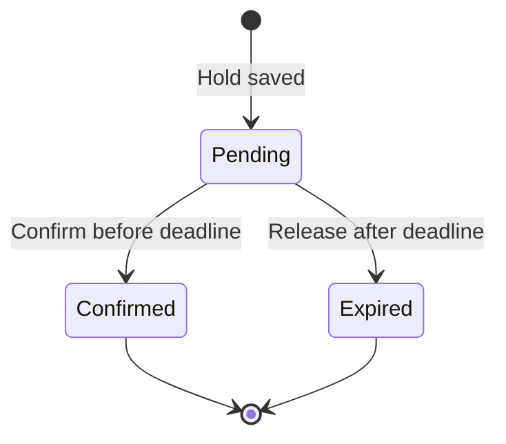

# 2. What the project does

The service helps stores run sales with limited quantities. A customer can hold one SKU after reviewing a cart and before a final purchase decision. A SKU is a product code, such as `TV-65-4K`.

The project does not include a cart, customer accounts, or payment integration. The confirmation endpoint simulates the final purchase decision. One reservation holds one SKU with a requested quantity; a whole cart is not reserved in one transaction.

## Sales

A sale has a name, start time, end time, and a list of products. Its products must already exist for that tenant. Prices must be positive and below the regular product price. Initial quantities must be positive.

New holds are allowed from the start time, including that instant, until the end time, excluding that instant. A hold created during a sale keeps its own deadline. It can be confirmed after the sale ends if the hold itself is still valid.

## A 100-unit example

Assume a sale has 100 units and every request asks for one unit:

1. The first 100 successful independent requests create 100 pending holds.
2. The remaining sale quantity becomes zero.
3. Request 101 receives `409 No reservable capacity.`
4. If a pending hold expires and is released, its quantity becomes available again, as long as the sale is still active.

No waiting-list position is created for request 101. The client must try again later. Automatic transfer from a waiting list is a future idea.

The service reduces available quota when the hold is created. Confirmation does not reduce it again. Expiry returns it. There is no separate physical inventory update yet.

## Reservation states

Expired records are kept for history. The worker does not delete reservations or orders. Confirmed holds are not released just because their original deadline passes.

The current development hold time is **60 seconds**. The fallback value, when no hold setting exists, is **600 seconds (10 minutes)**. Always read `expiresAt` from the reservation response. Changing configuration only changes new holds.

`canConfirm` becomes false at the deadline. The stored status may still say `Pending` until an expiry sweep updates it. Passing the deadline and returning capacity are therefore separate moments.

## Idempotency keys

The client sends an `Idempotency-Key` header when creating a hold. Generate a new random value for a new reservation attempt, then keep that value when retrying the same request after a timeout or a busy response. A UUID is suitable. Allowed characters are ASCII letters, digits, `-`, `_`, `.`, and `:`; the maximum length is 128.

The key belongs to a tenant, not just to one sale. Keys are case-sensitive. They are not customer IDs or access tokens.

| Situation | Result |
| --- | --- |
| New key and enough capacity | `201`, a new hold |
| Same key and same sale, SKU, and quantity after success | `200`, the existing reservation in its current state |
| Same key, but different sale, SKU, or quantity after success | `409 Idempotency key conflict.` |
| Previous request failed because capacity was full | No hold or key is saved; the same unchanged request can later receive `201` |
| A successfully created hold has now expired | Reusing its key returns that old reservation; it does not extend or recreate the hold |

For a new hold after an earlier successful hold expires, use a new key. For a rejected capacity request, keeping the same key is fine. The response header `Idempotency-Replayed` tells you whether creation returned an existing reservation.

## HTTP endpoints

All sale and reservation routes start with `/api/tenants/{tenantId}`. Tenant selection is in the URL, not a `tenant-id` header.

| Method | Route after the tenant prefix | Purpose / normal result |
| --- | --- | --- |
| POST | `/sales` | Create a sale; `201` |
| GET | `/sales?page=1&pageSize=20` | List sales; `200` |
| GET | `/sales/{saleEventId}` | Get sale details and quantity; `200` |
| POST | `/sales/{saleEventId}/reservations` | Create or replay a hold; `201` or `200` |
| GET | `/reservations/{reservationId}` | Read current reservation state; `200` |
| POST | `/reservations/{reservationId}/confirm` | Confirm without a request body; `202` |

Confirmation returns `202` because downstream work is represented by a pending job. It does not mean an order or payment has finished. Repeating confirmation for a confirmed reservation also returns `202` and does not add another job.

Other responses include `400` for invalid input, `404` for a missing resource in the tenant, `409` for an inactive sale or capacity/key conflict, and `410` when trying to confirm an expired hold. Some SQL contention errors return `503` with `Retry-After: 1`; retry creation with the same key and body.

Always inspect the problem response's `title` and `detail`. Different failures share the `409` status code.

Next: [Project structure](03-project-structure.md).
