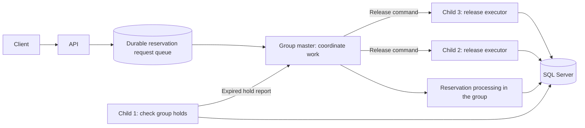

# 5. Ideas for improvement

This page describes future work. None of the proposals below should be read as a feature that already exists.

## Complete the processing pipeline

The next major step is a worker that consumes `ProcessingJobs`. It can run the planned order, inventory, and notification steps, initially with simple stubs where needed.

Add a safe job claim, a lease deadline, attempt count, next retry time, last error, and final status. A lease gives one worker temporary ownership. If that worker stops, another can take over after the lease ends. Each processing step must handle repeat delivery safely; a crash may happen after a step succeeds but before its result is saved.

Use retries with increasing delays and a maximum attempt count. After repeated failure, move the work to a dead-letter queue (DLQ), or an equivalent failed-job state that operators can inspect and retry. A DLQ holds work that cannot finish automatically; it does not fix the failure itself.

Define what happens when a confirmed purchase fails permanently. Returning quota needs an explicit, atomic compensation action, not ordinary pending-hold expiry. The current expiry worker never releases confirmed reservations.

## Proposed master-slave worker groups

The suggested design uses a master (coordinator) and three slaves (child workers) in each group. One child checks deadlines, while two others execute release work.

This is a design sketch, not the current flow. The assignment of reservation processing within the group would need a separate decision. The three child roles shown here describe the proposed expiry work.

The proposed flow would be:

1. The API saves a reservation request in a durable queue and returns a request ID.
2. A group processes the request and tries to create the hold using an atomic SQL quota check.
3. The client checks the request result. Only a successfully saved hold means the product is reserved.
4. The checking child finds expired pending holds owned by its group and reports them to the master.
5. The master assigns each release command to one available executor. The two executors can share the workload.
6. The executor marks the hold `Expired` and returns its quantity in one transaction. It keeps the record for history.

For the proposed 10-minute window, the deadline should start when the hold is created, not when the request first enters the queue. Queue acceptance does not guarantee stock. A queued request may still fail because the sale ends or capacity runs out before processing.

### Benefits

- Separate checking from release work when their workloads are very different.
- Scale release executors without adding the same number of checkers.
- Queue incoming requests to control how quickly work reaches the database.

### Extra complexity

- Group ownership must be stored durably. A process ID alone is not enough to find holds after a restart.
- If a master fails, another coordinator must take ownership. An old master that returns must not continue sending valid commands under an expired ownership claim.
- If a checker fails, its group still needs deadline checks. Otherwise those holds stay allocated.
- Reports and release commands need durable delivery, retries, and duplicate protection.
- Each release should be claimed by one executor. Broadcasting the same release to both does not increase useful work. SQL must still protect against duplicates.
- The queue needs size limits and fair handling across tenants. A queue by itself does not add processing capacity.
- The client needs a new pending-request screen or polling flow because reservation success is no longer immediate.

This design adds several failure and recovery paths. The current recommendation is to keep equal worker instances and add durable job claims first. A process manager or container platform can restart failed instances. Consider worker groups later if measurements show a clear need for separate checker and executor roles.

## Other priorities

| Area | Suggested change | Reason |
| --- | --- | --- |
| Local setup | Add Dockerfiles and Docker Compose for API, worker, and SQL Server | Make a fresh checkout easier to run; Compose is not present yet |
| Read traffic | Cache sale details with clear expiry and invalidation rules | Reduce repeated database reads; keep SQL as the final quota check |
| Access control | Authenticate callers and check tenant and reservation ownership | A tenant URL is not proof of access |
| Fairness | Add tenant limits and fair job scheduling | Stop one busy tenant from using all processing capacity |
| Observability | Centralize JSON logs; add queue age, expiry lag, error rate, and latency metrics | Find slow or failed work without reading every console |
| Health | Add database readiness and worker progress checks | Process liveness alone cannot prove the system is ready |
| Customer flow | Consider cancellation, multi-item holds, and an optional waiting list | Support a fuller checkout flow with explicit business rules |
| Data lifecycle | Define retention for old holds, keys, and completed jobs | Keep useful history without unlimited growth |

## Load and failure testing

The existing concurrency tests and capacity script check specific correctness rules. They are not proof of a production throughput target.

Agree on the expected traffic and response-time targets before choosing a load tool. Test a popular single SKU, many SKUs, several tenants, and a large expiry backlog. Measure response times, SQL waits, failures, and how long expired quota takes to return.

Once job processing exists, test worker crashes before and after each step, SQL outages, duplicate delivery, lease takeover, and DLQ recovery. Verify that a restart cannot repeat a business effect or lose a confirmed job.

See [testing](testing.md) for checks that can be run today.
